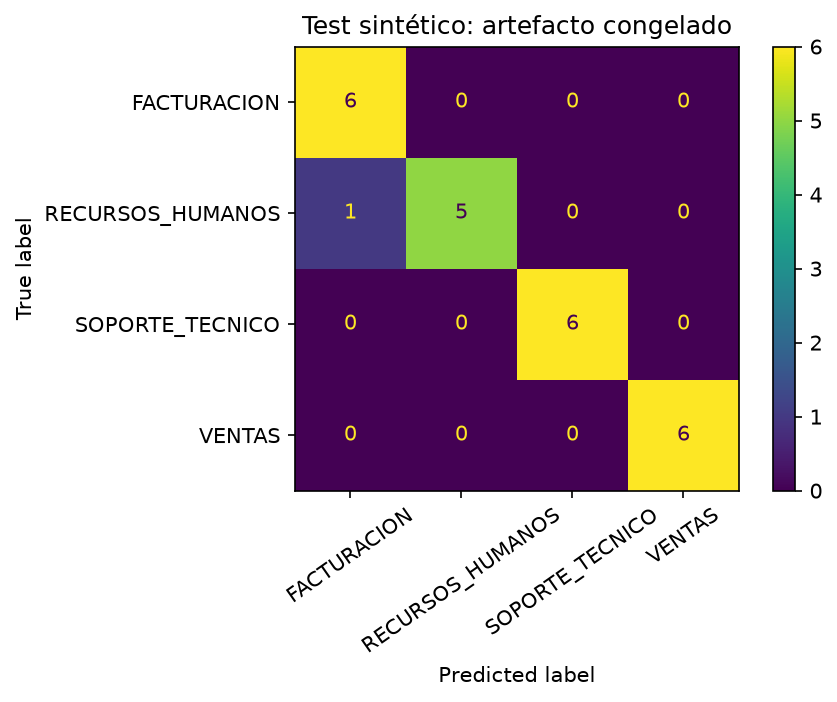
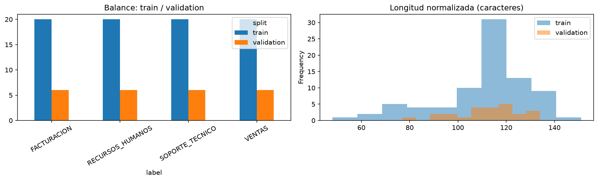

# Evaluación final del clasificador de correos

**Equipo:** Juan Camilo Gonzales y Juan Jose Solarte.
**Fuentes:** commit técnico `3f9a067`; cierre documental del 23 de noviembre de 2026.

El artefacto de referencia es **`tfidf-logreg-4899d09a3071f491`**, evaluado en el bloque técnico anterior y contrastado entonces con `/health`. El [reporte curado](evidencias/ia/evaluacion_artefacto.json) registra `servedArtifactVerified=true`; [manifiesto](evidencias/ia/manifest.json) y [procedencia](evidencias/ia/procedencia.json) identifican el archivo. En este cierre se verificaron archivos, huellas y correspondencia con notebooks, **sin entrenar, repetir test ni hacer una nueva medición HTTP**.

| Huella pública | SHA-256 |
|---|---|
| Artefacto servido | `b64848f287a8ccc9300a206edbc0aaed7e61df2a2b8d2096e6726fe7d265d652` |
| Dataset v0.3 | `3af898302b0c153a747979c380d3438e8ea1defef8cb29ec49f87a1db4ac0b06` |
| Código de entrenamiento | `3b643b4a9fd9994cd75b8cb9ad11075941f14aa94e79032e7eefd3a1720d2850` |
| Preprocesamiento | `e8d9a7dad97df019c182c935c18206532cc468583130c6f1ce5acb3d70c1a7f1` |

## Datos y protocolo

El [dataset propio sintético v0.3](../ai_service/data/README.md) contiene 128 correos en español redactados con asistencia de IA, sin correos reales ni fuentes externas: **80 train, 24 validation, 24 test**, cuatro categorías balanceadas (20/6/6 por categoría). Se verifican faltantes, IDs/textos normalizados duplicados y presencia de clases; no se descartan similitudes semánticas entre plantillas solo por esas comprobaciones.

`prepare_text` normaliza espacios. El pipeline TF-IDF de unigramas/bigramas (`strip_accents="unicode"`) se ajusta solo con train, junto con regresión logística (`random_state=42`, `max_iter=1000`). `C` se elige entre 0,5; 1; 3; 10; 30 por Macro-F1 en validation, desempate por log-loss y menor `C`. La referencia eligió **C=30**.

El baseline es `DummyClassifier(strategy="most_frequent")`. El umbral efectivo **0,45** es provisional y no se eligió con test. H-01=0,70 sigue siendo la hipótesis histórica, no validada ni sustituida silenciosamente. En validation, 0,40 obtuvo 21 asignaciones correctas y 0,45 obtuvo 20: no existe evidencia para llamar óptimo al 0,45.

El test permanece separado del ajuste y la selección, pero **ya fue evaluado en intervenciones anteriores**. Los resultados reproducen un modelo congelado, no una nueva evaluación ciega ni una autorización para optimizar con ese test.

## Validación, antes de la prueba

Sobre los 24 registros de validation: baseline con exactitud 25,0 % y Macro-F1 0,100; clasificador con 95,8 % y Macro-F1 0,958. Son resultados de selección, no una estimación independiente de generalización. Las métricas de test se calcularon aparte, aunque coincidan numéricamente.

## Comparación en la prueba final

| Modelo | Aciertos | Exactitud | Macro-F1 |
|---|---:|---:|---:|
| Base, predicción de la clase más frecuente | 6 de 24 | 25,0 % | 0,100 |
| TF-IDF y regresión logística | 23 de 24 | 95,8 % | 0,958 |

Cada fila de la matriz indica la categoría real y cada columna la predicción de mayor puntuación, antes de aplicar el umbral.

| Categoría real | Facturación | Recursos Humanos | Soporte Técnico | Ventas |
|---|---:|---:|---:|---:|
| Facturación | 6 | 0 | 0 | 0 |
| Recursos Humanos | 1 | 5 | 0 | 0 |
| Soporte Técnico | 0 | 0 | 6 | 0 |
| Ventas | 0 | 0 | 0 | 6 |

| Categoría (test, soporte 6 cada una) | Precision | Recall | F1 |
|---|---:|---:|---:|
| FACTURACION | 0,857 | 1,000 | 0,923 |
| RECURSOS_HUMANOS | 1,000 | 0,833 | 0,909 |
| SOPORTE_TECNICO | 1,000 | 1,000 | 1,000 |
| VENTAS | 1,000 | 1,000 | 1,000 |



## Enrutamiento y revisión

Con el umbral del 45 %, 20 de los 24 correos (83,3 %) se habrían asignado automáticamente. Los 20 coinciden con sus etiquetas. Los otros 4 (16,7 %) habrían requerido revisión humana.

El único error de categoría fue `SYN-040`, etiquetado Recursos Humanos y predicho Facturación. La revisión incluye ese caso; `SYN-078` es el error separado de validation. La precisión de enrutamiento automático de 100 % corresponde únicamente a los **20 casos aceptados de esta muestra**, no a todos los correos ni a correcciones efectuadas por operadores. La tasa real de correcciones humanas está **pendiente de medición**; no es cero.

## Tiempo de inferencia

No hay una nueva medición de latencia para este archivo en el cierre documental. Las cifras antiguas de otro artefacto no se atribuyen al actual. El [plan de pruebas](PLAN_Y_RESULTADOS_PRUEBAS.md) identifica una corrida API anterior y exige registrar entorno, n, mediana/p95 y alcance en la prueba integral definitiva. Medir solo `/predict` no equivale a medir registro, MongoDB, autenticación, proxy y navegador.

## Reproducción y límites

Con la demo levantada, ejecuta desde la raíz:

```powershell
docker compose exec -T ai python -m ai_service.evaluate_artifact --include-test --service-url http://127.0.0.1:8001 --output /tmp/evaluacion-servida.json
```

El comando evalúa el **archivo servido**, no reentrena, y rechaza discrepancias con `/health`. El [README IA](../ai_service/README.md) explica construcción/promoción, copia del reporte y entrega controlada del bundle. `/model/model.joblib` y su `manifest.json` están en la imagen, **no en Git**; `ai_service/artifacts/` sigue ignorado.

Los [notebooks](../ai_service/notebooks/README.md) reutilizan los módulos de servicio. La [ejecución conservada](evidencias/ia/ejecucion_notebooks.json) tiene tres notebooks y cero errores. Su modelo comparte versión y métricas con el servido; el checksum de su serialización puede diferir. No se afirma reproducción binaria.



Limitaciones: muestra pequeña, clases balanceadas por diseño, probabilidades no calibradas, posible parentesco de plantillas, datos solo en español y sin hilos/adjuntos reales. No se evaluaron diferencias por subgrupos empresariales, desempeño en producción ni ahorro de trabajo. La procedencia académica del corpus está documentada; no existe una licencia de distribución general del repositorio que deba presumirse. Nuevos datos requieren permisos, anonimización, revisión de sesgos y un test nuevo.
